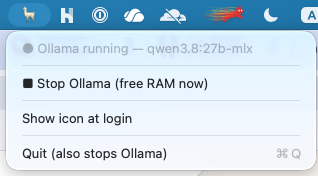

# OllamaBar

**English** | [ไทย](README.th.md)

[](https://github.com/yutna/ollama-bar/actions/workflows/build.yml)
[](https://github.com/yutna/ollama-bar/releases/latest)
[](LICENSE)

A tiny macOS menu bar toggle for a **local Ollama server** — start it when you
need it, stop it when you don't, and get your memory back instantly.

Ollama usually installs itself as a login service that always runs in the
background. On a laptop that can mean a multi-gigabyte model sitting in unified
memory long after you stopped using it. OllamaBar gives you one click instead:



| Action | What happens |
| --- | --- |
| **▶︎ Start Ollama** | runs `ollama serve` with sensible defaults (see below) |
| **🔥 Warm up model** | preloads your first generative model (embedding models are skipped) and pins it with `keep_alive` |
| **■ Stop Ollama** | unloads all models and terminates the server — memory is freed immediately |
| **Quit** | stops Ollama too (nothing keeps running in the background) |

Nothing auto-starts at boot by default; the menu bar icon is the only touch
point. "Show icon at login" brings back just the *icon* — the server still
starts only when you ask it to.

## Features

- One-click start / stop for `ollama serve`
- **Stop** frees model memory instantly instead of waiting for a keep-alive timeout
- Optimized defaults out of the box: keep-alive `-1`, 64k context, a single loaded model
- Warm-up button to preload a model before you open your editor (embedding-only models are skipped, and the model is pinned with `keep_alive`)
- Optional "Show icon at login" (icon only — Ollama itself stays off until you click Start)
- CLI mode for scripts (`--start`, `--stop`, `--status`, `--warm`, `--help`, `--version`); unknown options print the usage and exit 2
- Localized UI — English, ไทย, 日本語, 简体中文, 한국어, Español, Français, Deutsch — follows your system language
- Finds Ollama wherever it lives: Homebrew (Apple Silicon or Intel), MacPorts, `~/.local/bin`, version-manager shims, or the official app

## Requirements

- macOS 13 (Ventura) or newer
- [Ollama](https://ollama.com) installed (official app or Homebrew)
- To build: Xcode Command Line Tools (`xcode-select --install`)

## Install

### Download

Grab `OllamaBar.app.zip` from the [latest release](https://github.com/yutna/ollama-bar/releases/latest),
unzip, and move `OllamaBar.app` to `/Applications`. The build is a universal
binary (Apple Silicon + Intel) and ad-hoc signed, so Gatekeeper may ask you to
confirm the first launch. You can also clear the quarantine flag yourself:

```sh
xattr -dr com.apple.quarantine /Applications/OllamaBar.app
```

### Build from source

```sh
git clone https://github.com/yutna/ollama-bar.git
cd ollama-bar
make install              # build and install to /Applications
# or: PREFIX=~/Applications make install
```

Then launch **OllamaBar** and look for the 🦙 icon in the menu bar.

Other targets: `make build` (into `build/`), `make run`, `make test`, `make lint`,
`make format`, `make release-zip`, `make uninstall`.

### Uninstall

If you turned on **Show icon at login**, switch it off from the menu first (or
remove OllamaBar in *System Settings → General → Login Items*) — macOS keeps
the login item registered even after the app is deleted. Then remove the app:

```sh
make uninstall            # or: rm -rf /Applications/OllamaBar.app
```

## Usage

1. Click the 🦙 icon.
2. Choose **Start Ollama**.
3. Optionally choose **Warm up model**.
4. Open your editor / coding agent (OpenCode, Claude Code, [`ollama launch`](https://docs.ollama.com/integrations), …) and work.
5. When you're done, click 🦙 → **Stop Ollama**. Memory is back immediately.

The icon is dimmed while the server is stopped.

## Defaults

These are applied to the server that OllamaBar starts:

| Setting | Value | Why |
| --- | --- | --- |
| `OLLAMA_KEEP_ALIVE` | `-1` | keep the model resident for the whole session (no reload stalls) |
| `OLLAMA_CONTEXT_LENGTH` | `65536` | [Ollama recommends 64k+](https://docs.ollama.com/context-length) for agents/coding tools |
| `OLLAMA_MAX_LOADED_MODELS` | `1` | never let a second model eat your unified memory |
| `OLLAMA_FLASH_ATTENTION` | `1` | (llama.cpp backend) |
| `OLLAMA_KV_CACHE_TYPE` | `q8_0` | (llama.cpp backend) |

Override them with environment variables if you launch the binary yourself:

```sh
OLLAMABAR_CONTEXT_LENGTH=32768 ./build/OllamaBar.app/Contents/MacOS/OllamaBar --start
```

Supported overrides: `OLLAMABAR_PORT`, `OLLAMABAR_KEEP_ALIVE`,
`OLLAMABAR_CONTEXT_LENGTH`, `OLLAMABAR_MAX_LOADED_MODELS`,
`OLLAMABAR_FLASH_ATTENTION`, `OLLAMABAR_KV_CACHE_TYPE`.

Every override is validated: a typo, an out-of-range port or an invalid
duration falls back to the default instead of pointing the app at a server
that cannot exist. `OLLAMABAR_PORT` is also passed to the server
(`OLLAMA_HOST=127.0.0.1:<port>`) and to every `ollama` CLI call, so the app,
the server and `ollama stop` always agree on where the API lives.

## CLI mode

Handy for scripts or shell aliases:

```sh
BIN=/Applications/OllamaBar.app/Contents/MacOS/OllamaBar
$BIN --start    # start server with defaults
$BIN --status   # stopped | running | running model-loaded
$BIN --warm     # preload first installed model
$BIN --stop     # unload models + stop server
```

Failures are visible to scripts: `--start`, `--stop` and `--warm` exit non-zero
when the action did not succeed (`--stop` prints `still-running`, `--warm`
prints `not-loaded`). `--status` always exits 0 and prints the state.

The CLI always answers in English so scripts never have to parse translated
output.

## How it works

- **Start** spawns `ollama serve` as a child process with the environment
  above (including `OLLAMA_HOST=127.0.0.1:<port>`) and logs to
  `~/.ollama/logs/server.log`. The log is rotated when it exceeds 10 MB.
- **Stop** asks Ollama to unload each loaded model, then terminates the server
  (and any user-owned `ollama serve` / `ollama runner` process, so memory is
  always freed), escalating to SIGKILL if a process refuses to exit.
- The app is ad-hoc code-signed locally when built.

## Localization

The UI ships in English, Thai, Japanese, Simplified Chinese, Korean, Spanish,
French and German (`resources/<language>.lproj/Localizable.strings`) and follows
your system language. Adding another language is just a new `.lproj` directory:
copy `resources/en.lproj/`, translate the values, list the language in
`resources/Info.plist` — `make lint` checks key parity, format specifiers and
the `Info.plist` entry for you.

## Notes & limitations

- Not affiliated with [Ollama](https://ollama.com) — just a convenience wrapper
  around the CLI you already have.
- "Stop" terminates *all* of your user-owned `ollama serve` processes, including
  ones started outside the app (e.g. `brew services`). If you prefer the
  background service instead, don't run both.
- The app only manages the server lifecycle; pulling models and configuration
  files are still plain Ollama (`ollama pull …`, `~/.ollama/…`).

## Contributing

Issues and pull requests are welcome — [CONTRIBUTING.md](CONTRIBUTING.md) has
the details, and the [Code of Conduct](CODE_OF_CONDUCT.md) applies to all
project spaces. For security reports see [SECURITY.md](SECURITY.md).

## License

[MIT](LICENSE) © Yutthana Siphuengchai
