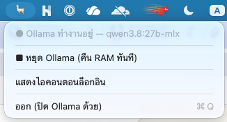

# OllamaBar

[English](README.md) | **ไทย**

[](https://github.com/yutna/ollama-bar/actions/workflows/build.yml)
[](https://github.com/yutna/ollama-bar/releases/latest)
[](LICENSE)

ปุ่มเปิด/ปิด **Ollama server** บนเครื่องของคุณ ผ่านเมนูบาร์ macOS —
เปิดเมื่อใช้ ปิดเมื่อเลิกใช้ แล้วได้ RAM คืนทันที

ปกติ Ollama จะติดตั้งตัวเองเป็น service ที่รันเบื้องหลังตลอดเวลา บนโน้ตบุ๊ก
นั่นหมายถึงโมเดลขนาดหลายกิกะไบต์จะกิน unified memory อยู่ตลอดแม้คุณเลิกใช้ไปนานแล้ว
OllamaBar เปลี่ยนให้เหลือแค่คลิกเดียว:



| การทำงาน | เกิดอะไรขึ้น |
| --- | --- |
| **▶︎ เริ่ม Ollama** | รัน `ollama serve` พร้อมค่าที่ปรับมาแล้ว (ดูด้านล่าง) |
| **🔥 โหลดโมเดลล่วงหน้า** | โหลดโมเดลแรกที่ไม่ใช่โมเดล embedding ล่วงหน้า (โมเดล embedding จะถูกข้าม) และปักหมุดด้วย `keep_alive` |
| **■ หยุด Ollama** | unload ทุกโมเดลและปิด server — คืน RAM ทันที |
| **ออก** | ปิด Ollama ด้วย (ไม่มีอะไรค้างอยู่ในเบื้องหลัง) |

ค่าเริ่มต้นคือไม่ตั้งให้ทำงานอัตโนมัติตอนบูตเลย ไอคอนบนเมนูบาร์คือจุดเดียวที่คุณแตะ
ส่วน "แสดงไอคอนตอนล็อกอิน" จะเปิดแค่ *ไอคอน* — ตัว server ยังต้องกดเริ่มเองเท่านั้น

## ฟีเจอร์

- คลิกเดียวเปิด/ปิด `ollama serve`
- ปุ่ม **หยุด** คืน memory ทันที ไม่ต้องรอ keep-alive timeout
- ค่าเริ่มต้นที่เหมาะกับงานจริง: keep-alive `-1`, context 64k, โหลดทีละโมเดล
- ปุ่ม warm-up โหลดโมเดลก่อนเปิด editor (ข้ามโมเดล embedding ล้วน และปักหมุดโมเดลด้วย `keep_alive`)
- "แสดงไอคอนตอนล็อกอิน" แบบเลือกได้ (เฉพาะไอคอน — Ollama ยังไม่ทำงานจนกว่าจะกดเริ่ม)
- โหมด CLI สำหรับ script (`--start`, `--stop`, `--status`, `--warm`, `--help`, `--version`) — option ที่ไม่รู้จักจะพิมพ์ usage แล้ว exit 2
- UI หลายภาษา — English, ไทย, 日本語, 简体中文, 한국어, Español, Français, Deutsch — ตามภาษาของระบบ
- หา Ollama เจอไม่ว่าจะติดตั้งที่ไหน: Homebrew (Apple Silicon หรือ Intel), MacPorts, `~/.local/bin`, shim ของ version manager หรือแอปทางการ

## ความต้องการของระบบ

- macOS 13 (Ventura) ขึ้นไป
- ติดตั้ง [Ollama](https://ollama.com) แล้ว (แอปทางการหรือ Homebrew)
- ถ้าจะ build เอง: Xcode Command Line Tools (`xcode-select --install`)

## การติดตั้ง

### ดาวน์โหลด

ดาวน์โหลด `OllamaBar.app.zip` จาก [release ล่าสุด](https://github.com/yutna/ollama-bar/releases/latest)
แตกไฟล์ แล้วย้าย `OllamaBar.app` ไปไว้ใน `/Applications` ตัว build เป็น
universal binary (Apple Silicon + Intel) และเซ็นแบบ ad-hoc ดังนั้น Gatekeeper
อาจถามยืนยันตอนเปิดครั้งแรก หรือจะล้าง quarantine flag เองก็ได้:

```sh
xattr -dr com.apple.quarantine /Applications/OllamaBar.app
```

### Build จากซอร์ส

```sh
git clone https://github.com/yutna/ollama-bar.git
cd ollama-bar
make install              # build แล้วติดตั้งไป /Applications
# หรือ: PREFIX=~/Applications make install
```

จากนั้นเปิด **OllamaBar** และมองหาไอคอน 🦙 บนเมนูบาร์

เป้าหมายอื่นๆ ของ make: `build`, `run`, `test`, `lint`, `format`, `release-zip`, `uninstall`

### ถอนการติดตั้ง

ถ้าเปิด **แสดงไอคอนตอนล็อกอิน** ไว้ ให้ปิดจากเมนูก่อน (หรือลบ OllamaBar ใน
*System Settings → General → Login Items*) — macOS จะเก็บ login item ไว้แม้ลบแอปแล้ว
จากนั้นลบแอป:

```sh
make uninstall            # หรือ: rm -rf /Applications/OllamaBar.app
```

## วิธีใช้

1. คลิกไอคอน 🦙
2. เลือก **เริ่ม Ollama**
3. ถ้าต้องการ เลือก **โหลดโมเดลล่วงหน้า**
4. เปิด editor / coding agent (OpenCode, Claude Code, [`ollama launch`](https://docs.ollama.com/integrations), …) แล้วทำงานได้เลย
5. เลิกใช้แล้วคลิก 🦙 → **หยุด Ollama** ได้ RAM คืนทันที

ไอคอนจะจางลงเมื่อ server หยุดอยู่

## ค่าเริ่มต้น

ค่าต่อไปนี้จะถูกใช้กับ server ที่ OllamaBar เป็นตัวเปิด:

| ค่า | ค่าที่ตั้ง | เหตุผล |
| --- | --- | --- |
| `OLLAMA_KEEP_ALIVE` | `-1` | ให้โมเดลอยู่ใน memory ตลอด session (ไม่ต้องโหลดใหม่) |
| `OLLAMA_CONTEXT_LENGTH` | `65536` | [Ollama แนะนำ 64k+](https://docs.ollama.com/context-length) สำหรับ agent/เครื่องมือเขียนโค้ด |
| `OLLAMA_MAX_LOADED_MODELS` | `1` | กันไม่ให้โมเดลที่สองมากิน unified memory |
| `OLLAMA_FLASH_ATTENTION` | `1` | (backend llama.cpp) |
| `OLLAMA_KV_CACHE_TYPE` | `q8_0` | (backend llama.cpp) |

ถ้ารัน binary เอง สามารถ override ผ่าน environment variable ได้:

```sh
OLLAMABAR_CONTEXT_LENGTH=32768 ./build/OllamaBar.app/Contents/MacOS/OllamaBar --start
```

ค่าที่ override ได้: `OLLAMABAR_PORT`, `OLLAMABAR_KEEP_ALIVE`,
`OLLAMABAR_CONTEXT_LENGTH`, `OLLAMABAR_MAX_LOADED_MODELS`,
`OLLAMABAR_FLASH_ATTENTION`, `OLLAMABAR_KV_CACHE_TYPE`

ทุกค่าจะถูกตรวจสอบก่อนใช้: พิมพ์ผิด พอร์ตเกินช่วง หรือ duration ที่ไม่ถูกต้อง
จะ fallback กลับไปใช้ค่าเริ่มต้น แทนที่จะชี้แอปไปยัง server ที่ไม่มีอยู่จริง
และ `OLLAMABAR_PORT` จะถูกส่งต่อไปให้ server (`OLLAMA_HOST=127.0.0.1:<port>`)
รวมถึงคำสั่ง `ollama` ทุกครั้ง ทำให้แอป server และ `ollama stop` ตรงกันเสมอ

## โหมด CLI

เหมาะกับ script หรือ shell alias:

```sh
BIN=/Applications/OllamaBar.app/Contents/MacOS/OllamaBar
$BIN --start    # เปิด server ด้วยค่าที่ปรับไว้
$BIN --status   # stopped | running | running model-loaded
$BIN --warm     # โหลดโมเดลแรกที่ติดตั้งไว้ล่วงหน้า
$BIN --stop     # unload โมเดล + ปิด server
```

ถ้าคำสั่งไม่สำเร็จ script จะรู้ได้: `--start`, `--stop` และ `--warm` จะ exit
non-zero เมื่อทำงานไม่สำเร็จ (`--stop` จะพิมพ์ `still-running`, `--warm` จะพิมพ์
`not-loaded`) ส่วน `--status` จะ exit 0 เสมอและพิมพ์สถานะออกมา

CLI จะตอบเป็นภาษาอังกฤษเสมอ เพื่อให้ script ไม่ต้อง parse ข้อความที่แปลแล้ว

## กลไกภายใน

- **เริ่ม** spawn `ollama serve` เป็น child process พร้อม environment ด้านบน
  (รวม `OLLAMA_HOST=127.0.0.1:<port>`) และเขียน log ไปที่ `~/.ollama/logs/server.log`
  โดย log จะถูกหมุนเมื่อเกิน 10 MB
- **หยุด** สั่ง Ollama unload โมเดลที่โหลดอยู่ทีละตัว แล้วปิด server
  (รวมถึง `ollama serve` / `ollama runner` ที่ผู้ใช้เป็นเจ้าของทุกตัว เพื่อให้ได้ RAM คืนแน่นอน)
  และจะส่ง SIGKILL ต่อหาก process ไม่ยอมปิด
- ตัวแอปถูกเซ็นแบบ ad-hoc ตอน build

## หลายภาษา

UI มีให้เลือก 8 ภาษา: อังกฤษ ไทย ญี่ปุ่น จีนตัวย่อ เกาหลี สเปน ฝรั่งเศส และเยอรมัน
(`resources/<ภาษา>.lproj/Localizable.strings`) โดยตามภาษาของระบบ
การเพิ่มภาษาอื่นทำได้แค่วางโฟลเดอร์ `.lproj` ใหม่: คัดลอกจาก `resources/en.lproj/`
แล้วแปลค่า จากนั้นเพิ่มรหัสภาษาใน `resources/Info.plist` — `make lint` จะตรวจ
ความครบของ key, format specifier และรายการใน `Info.plist` ให้เอง

## หมายเหตุและข้อจำกัด

- โปรเจกต์นี้ไม่มีความเกี่ยวข้องกับ [Ollama](https://ollama.com) — เป็นแค่ตัวช่วยครอบ CLI ที่คุณมีอยู่แล้ว
- **หยุด** จะปิด `ollama serve` ทุกตัวที่เป็นของผู้ใช้คนนี้ รวมถึงตัวที่เปิดเองจากข้างนอก
  (เช่น `brew services`) ถ้าคุณใช้ background service อยู่แล้ว ก็ไม่ต้องรันทั้งสองอย่าง
- แอปนี้จัดการแค่ lifecycle ของ server — การ pull โมเดลและไฟล์ config ยังใช้ Ollama ปกติ (`ollama pull …`, `~/.ollama/…`)

## การมีส่วนร่วม

ยินดีรับ issue และ pull request — อ่านรายละเอียดได้ที่ [CONTRIBUTING.md](CONTRIBUTING.md)
และ [Code of Conduct](CODE_OF_CONDUCT.md) มีผลกับทุกพื้นที่ของโปรเจกต์
สำหรับการรายงานด้านความปลอดภัย ดู [SECURITY.md](SECURITY.md)

## สัญญาอนุญาต

[MIT](LICENSE) © Yutthana Siphuengchai
